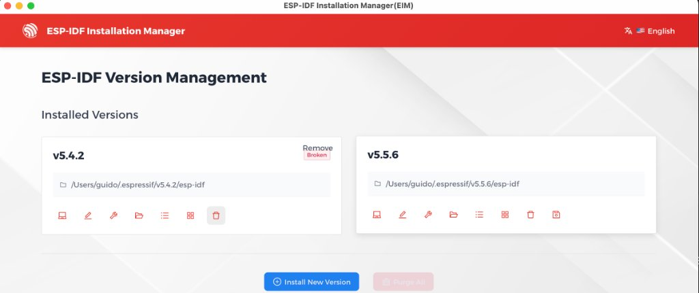
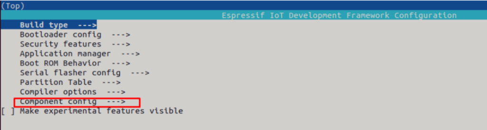
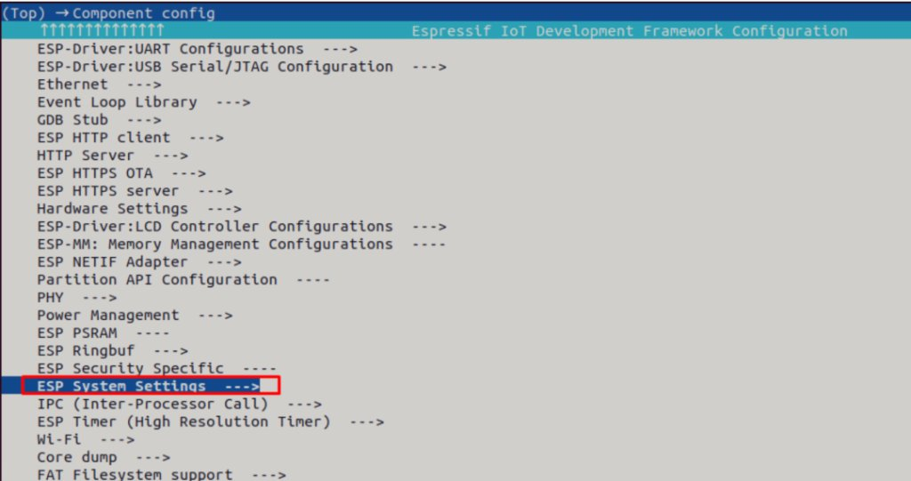
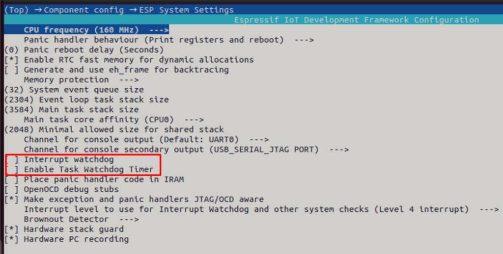

# realtime-so

---

## 🔧 Build y Flash del ESP32

### Prerequisitos

Tener instalado **ESP-IDF Installation Manager (EIM) v5.5.6**.



---

### 1. Abrir la terminal desde EIM y pararse en el directorio del proyecto ESP32

Abrir la terminal **desde el EIM** (usando el ícono de terminal en la versión v5.5.6) y luego navegar a la carpeta `esp32`:

```bash
cd ./esp32
```

---

### 2. Configurar el target

```bash
idf.py set-target esp32
```

---

### 3. Configurar el proyecto (menuconfig)

```bash
idf.py menuconfig
```

> [!IMPORTANT]
> Se recomienda **deshabilitar el Watchdog** para evitar reinicios inesperados durante el desarrollo.

Seguir la siguiente ruta dentro del menú:

**`Component config`** →



**`ESP System Settings`** →



Deshabilitar las siguientes opciones (deben aparecer `[ ]` sin asterisco):

- `[ ] Interrupt watchdog`
- `[ ] Enable Task Watchdog Timer`



---

### 4. Compilar el proyecto

```bash
idf.py build
```

> [!NOTE]
> Si necesitás agregar bibliotecas externas, hacelo antes de este paso.

---

### 5. Verificar que el microcontrolador sea detectado

**Linux:**
```bash
ls /dev/ttyUSB*
```

**Mac:**
```bash
ls /dev/cu.*
```

---

### 6. Dar permisos al puerto serie (solo Linux)

```bash
sudo chmod 777 /dev/ttyUSB0
```

---

### 7. Flashear el firmware

Asegurarse de tener el ESP32 conectado por USB y ejecutar:

**Linux:**
```bash
idf.py flash
```

**Mac:**
```bash
idf.py -p /dev/cu.usbserial-0001 flash
```

> [!NOTE]
> En Mac el puerto puede variar. Verificar el nombre exacto con `ls /dev/cu.*` antes de flashear.

---

### 8. Monitorear la salida serie (debug)

```bash
idf.py monitor
```

> [!TIP]
> Para salir del monitor usar `Ctrl + ]`.